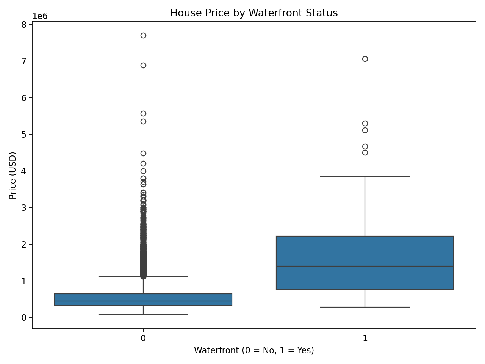
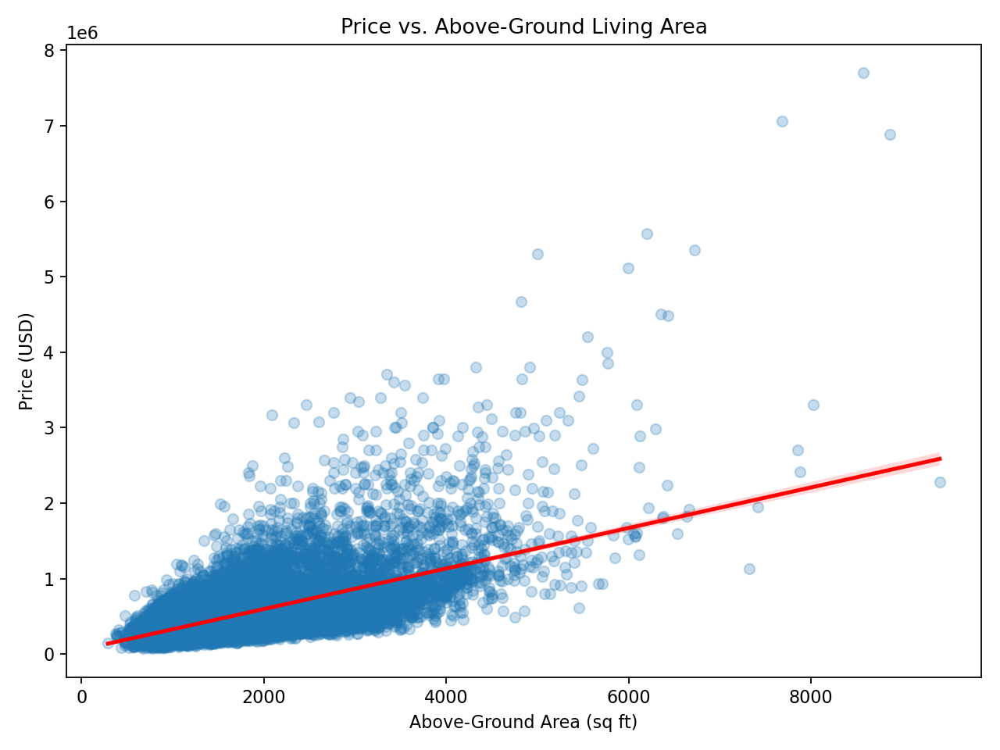

# House Price Analysis in King County, USA

By PENG YUANYUAN. Portfolio adaptation of my completed CISC7204 Assignment 01, Module 06 Final Project.

## Research question
How are housing characteristics associated with sale prices, and how well can regression models predict prices for homes in King County?

## Dataset and permissions
The course dataset contains 21,613 house sale records from May 2014 to May 2015 in King County, including Seattle. The prediction target is `price` in USD.

- Original source: [House Sales in King County, USA, by harlfoxem](https://www.kaggle.com/datasets/harlfoxem/housesalesprediction).
- Course-modified source: [IBM Skills Network CSV](https://cf-courses-data.s3.us.cloud-object-storage.appdomain.cloud/IBMDeveloperSkillsNetwork-DA0101EN-SkillsNetwork/labs/FinalModule_Coursera/data/kc_house_data_NaN.csv).
- [Submitted coursework repository](https://github.com/Pengyuanyuanmo/CISC7204-MC663623-2026GitHub/tree/main/Module06).

The original dataset is described as CC0 by the [ModernDive dataset documentation](https://cran.r-universe.dev/moderndive/doc/manual.html). The course version is modified. This repository links to the course CSV rather than redistributing that file or the IBM notebook; no licence is granted here over third-party materials. Original author credits are available in the linked coursework notebook.

## Methods and tools
Python, pandas, NumPy, Matplotlib, Seaborn and scikit-learn. Remove identifier/index columns, fill missing bedroom and bathroom values with their column means, explore relationships, fit linear and polynomial models, then evaluate Ridge models on an 85%/15% train/test split (`random_state=1`, `alpha=0.1`).

`analysis.py` adapts the original completed code for local execution. It replaces browser-only download steps with local CSV loading when available, otherwise reading from the official course URL, avoids chained assignment during mean imputation, and exports figures. Model choices and the original preprocessing order are retained.

## Findings
The local adaptation was rerun successfully on 2026-10-16. The values below are those saved in the original GitHub notebook and in `results.json`:

| Result | Value | Evaluation scope |
|---|---:|---|
| Above-ground area–price correlation | 0.6056 | Entire dataset, descriptive |
| Living-area linear regression R² | 0.492853 | In-sample |
| Multiple linear regression R² | 0.657649 | In-sample |
| Polynomial pipeline R² | 0.751218 | In-sample |
| Ridge R² | 0.647876 | Test set |
| Polynomial Ridge R² | 0.700274 | Same test set |

R² measures explained variation relative to a mean baseline; 0.700274 is not “70% prediction accuracy.” In-sample scores do not demonstrate generalization.

**Reproducibility note.** A clean rerun on 2026-11-23 (Python 3.12.7, scipy 1.17.1) reproduced the correlation, the living-area R² and both test-set Ridge R² values to six decimal places. The two unregularized multi-feature in-sample scores differed slightly (multiple linear 0.657606, polynomial pipeline 0.750509). A likely cause is exact collinearity in the feature set: `sqft_living` equals `sqft_above + sqft_basement` in every row, so ordinary least squares on these features is numerically sensitive to library versions. The Ridge models are regularized and were stable.



The boxplots compare group medians, spread and outliers. Group sizes differ substantially, so an absolute outlier count is not an outlier rate or proof that waterfront status causes a price difference.



Above-ground area has a positive association with price (r ≈ 0.606); substantial dispersion remains. Association does not establish causation.

## Limitations and next improvement
This is an educational analysis of an older, geographically restricted dataset. Mean imputation occurs before the train/test split in the original assignment, so test-set information enters preprocessing. The feature list also contains an exactly collinear set (`sqft_living`, `sqft_above`, `sqft_basement`), which makes unregularized coefficients unstable. The next improvement is to remove one of those redundant features, fit an imputer on training data inside a pipeline, add cross-validation and error metrics, and examine residuals. Those improvements have not yet been implemented or evaluated.

## Run the analysis
Python 3.12 was used for the portfolio adaptation on macOS. Open Terminal in this repository folder:

```sh
python3 -m venv .venv
source .venv/bin/activate
python -m pip install -r requirements.txt
python analysis.py
```

The script reads `housing_course.csv` if you supply that exact course dataset locally; otherwise it reads the linked IBM course CSV online. Internet access is required for dependency installation and for the default data-loading path. The original uploaded `housing.csv` differs from the version actually read by the notebook: the course version has 13 missing bedroom and 10 missing bathroom values. Do not substitute the other file when reproducing these results. Running the script regenerates the two PNGs and `results.json` in the repository root. Use `analysis.py` for this workflow; the linked original notebook retains its classroom environment steps.

## Attribution and status
The course notebook is based on IBM Skills Network material by Joseph Santarcangelo, with contributions from Michelle Carey and Mavis Zhou. My completed coursework supplies the solutions and saved outputs; AI assistance helped organize this portfolio adaptation, documentation and verification. Status: completed. The portfolio website is published at [pengyuanyuanmo.github.io/data-science-portfolio](https://pengyuanyuanmo.github.io/data-science-portfolio/). Classmate feedback (add a short Key Takeaways summary) was addressed in the portfolio repository commit "Add Key Takeaways box after portfolio feedback".
